# Netcode Issues: Impact Analysis and Dependency Graph

Companion to [known-issues.md](known-issues.md). That file lists findings; this one answers two questions about
them:

1. Which findings touch netcode or networking, and would any of them degrade a networked session (lag,
   desync/rubber-banding, connection failures, wasted bandwidth, server load)?
2. How do the findings depend on, block, or interact with each other, so fixes can be ordered sensibly?

Issue IDs (`N1`, `F7`, `G1`, ...) are the ones used in known-issues.md. Impact ratings are about the **player's
experience of a live multiplayer match**, not code quality. Claims were re-checked against the source where noted;
anything marked "unverified" follows from code reading only and was not run.

---

## 1. Summary

| Impact | Issues | What a player would notice |
|---|---|---|
| **High** | N1 | Packet drops at high player counts: input lag, rubber-banding, late hits, possible disconnects. |
| **Medium** | N3, N2, G1, G3, F7, N6 | Join-time churn and phantom ships (N3); unbounded snapshot cost at 150 players (N2); rubber-banding on traffic hits (G1); "invisible" damage that looks like a desync (G3); remote ships spinning on barrel rolls (F7); load tests that under-report real bandwidth, so N1/N2 go unnoticed (N6). |
| **Low** | N4, N5, N7, N8, N9, N10, N13, N14, F3 | Latent or cosmetic today; become real when the project changes (ghost modes, new ghost types, build pipeline). |
| **None (netcode section, hygiene only)** | N11, N12 | Dead code and an editor `using`; no runtime network effect. Can break the server build later (N12). |

Nothing in the list causes a desync in the strict sense (client and server simulating different results from the
same inputs). The project is server-authoritative and `MoveJob` runs identically on both sides. The network risks
are instead: transport saturation (N1), snapshot volume (N2), prediction corrections from non-authoritative content
(G1), and presentation disagreeing with server state (G3, F7).

---

## 2. Which issues are netcode issues

### 2.1 Netcode section (N1–N14)

All fourteen live in networking code paths, but they split into three groups:

| Group | Issues | Network effect in a live match |
|---|---|---|
| Transport / bandwidth / server load | N1, N2, N5, N8, N10 | Yes, scale-dependent. |
| Connection and session flow (UGS SDK) | N3, N4, N11 | Yes for N3; N4 unverified; N11 none. |
| Replication correctness and latent hazards | N7, N9, N13 | Not today; latent. |
| Test and build pipeline | N6, N12, N14 | Indirect: hides or breaks the above. |

### 2.2 Network-relevant issues filed under other sections

These are not in the Netcode table but their symptom is produced by, or only visible in, networked play:

| Issue | Why it belongs in a netcode review |
|---|---|
| **F7** | `RollRadians`/`BaseRoll` are replicated floats interpolated by Netcode. The spin is an artefact of interpolating a wrapping angle across a snapshot boundary, so it only affects remote ghosts. Pure replication issue. |
| **F3** | Mouse deltas are sampled per frame but the command is per tick; intermediate deltas are lost. It is client-local, but it degrades the quality of the input stream sent to the server and therefore of prediction. |
| **F2** | `RollAccumulationSpeed` is per tick. Because the same code runs in server simulation and owner prediction with identical `dt`, there is **no** desync risk. Listed for completeness: changing the tick rate would change the feel on both sides equally. |
| **G1** | Traffic is client-only and not authoritative. A collision with traffic on the client is not reproduced by the server, so the next snapshot corrects the owner's ship: visible rubber-banding. This is the clearest prediction-correction source in the project. |
| **G3** | `DamageJob` (server-only) ignores laser energy, while clients hide the beam at zero energy. The victim takes damage from a laser nobody can see. Mechanically correct on the server, but it presents to players as a hit-registration desync. |

Issues with **no** network dimension: F1, F4, F5, F6, F8, F9, G2, G4, G5. (F1's collision throttle cut runs in
prediction on both sides and fails identically on both, so even its failure is consistent.)

---

## 3. Impact assessment per issue

Format: impact, symptom category, rationale, and what was checked.

### High

**N1 — 150-player driver constructor never registered.**
Category: lag, packet loss, disconnects. Rationale: `MegacityMetroDriverConstructor` raises send/receive queue
capacity to `150 * 5` but is referenced only by a doc comment; `NetworkStreamReceiveSystem.DriverConstructor` is
set only inside `CustomEntitiesNetworkHandler.SetupDriverConstructor()`, which runs in the client process after an
SDK session join. The dedicated server therefore runs with Unity Transport's default queue sizes. With 150
connections sending command packets every tick and the server emitting one snapshot per connection per tick, a
burst that exceeds the queue is dropped by the transport (the "error code 5" warnings the original fix targeted).
Dropped commands cause input gaps the server fills by repeating the last command, which the owner then sees as
rubber-banding on reconciliation; dropped snapshots stall interpolation for everyone. Sustained drops will trip
Netcode's disconnect timeout. The constructor file itself notes it was added "to address performance issues, need
to keep". Verified: grep for `DriverConstructor =` shows the single SDK assignment; `NetCodeBootstrap.Initialize`
does not set it. Severity scales with player count; at small counts the default is sufficient, which is why it is
invisible in editor testing.

### Medium

**N3 — Double connection through the Multiplayer Services SDK.**
Category: connection churn, join latency, phantom ghosts. Rationale: `CustomEntitiesNetworkHandler.ConnectAsync`
connects `ClientServerBootstrap.ClientWorld` and waits up to 10 s for `Connected`; `MatchMakingConnector` then
calls `ServerConnectionUtils.ConnectToServer`, which runs `DestroyActiveSimulationWorld()` (disposing the world the
SDK just connected) and connects a fresh `ClientWorld`. Effects on the server for every join: a connect and a
disconnect, a ship instantiated and destroyed via `LinkedEntityGroup`, a spawn point consumed in
`ServerInGame.m_UsedPositions`, and two `ConnectionStateInfoRequest` broadcasts (see N5). Other players may see a
nameless ship ghost appear at a spawn point and vanish (visuals are suppressed until `PlayerName` replicates, so it
is usually a bare entity). Join time includes a full extra handshake. The first connection never reaches
`SetPlayerInfoRequest`, so the roster and UGS session player list are not corrupted. Not high because the match
state recovers fully and the SDK's own cleanup is tolerant of the disposed world today; fragile if the SDK starts
relying on its connection entity.

**N2 — `GhostSendSystemData { MinSendImportance = 2 }` created in the client world.**
Category: bandwidth, server CPU at scale. Rationale: `GhostSendSystem` runs only in server worlds, so the singleton
created in `ClientInGame.OnCreate` is never read. The intended behaviour (skip ghosts whose accumulated importance is
below 2 for this snapshot) is inert; every ghost competes for every snapshot and far ships are serialised at the
same per-snapshot cost as near ones. Bandwidth stays bounded by snapshot packet size, so this is a throughput and
server-CPU concern rather than a correctness one. Medium because at the 150-player design target the server is the
bottleneck, and because the fix is a one-line move; interacts with N10 (see §4).

**G1 — Traffic is client-only and non-authoritative.**
Category: prediction corrections (rubber-banding). Rationale: traffic vehicles exist only in `Client/Traffic/*`
and in the client's physics world. When the owner's predicted ship hits traffic, the client applies a collision
response the server never computes; the next snapshot restores the server position and `MegacityMetroSmoothingAction`
slides the ship back at 0.5 units/frame (errors over 20 units snap). Dense traffic lanes therefore produce visible
corrections, and the correction magnitude grows with RTT. Medium rather than high because traffic is cosmetic by
design and the smoothing hides small errors; high-speed head-on hits at high ping will snap.

**G3 — Laser deals damage at zero energy.**
Category: perceived hit-registration desync. Rationale: `LaserJob`'s gate `Energy > 0 || IsDead == 0` is always
true for a living ship, so `IsShooting` and `DetectedTarget` remain set; server-only `DamageJob` applies damage
while all clients hide the beam when `Energy <= 0`. The victim loses health with no visible attacker beam and the
attacker sees no beam yet scores a kill. Unverified at runtime (marked "Verify" in known-issues.md). Medium
because, although the server is internally consistent, the player-facing symptom is indistinguishable from a
netcode bug and will generate "I got hit by nothing" reports.

**F7 — Remote ships spin when `BaseRoll` wraps at ±π.**
Category: replication interpolation artefact. Rationale: `MoveJob` wraps `BaseRoll` from π to −π in one tick;
`RollRadians` (which includes `BaseRoll`) is replicated as a quantised float with `Interpolate`, so interpolating
clients sweep through the full 2π between two snapshots. Only interpolated (remote) ghosts show it; the owner
reconstructs rotation from predicted state and is unaffected. Medium: it is cosmetic but frequent (every full barrel
roll near other players) and clearly network-caused.

**N6 — Thin-client input bug.**
Category: test fidelity for all scale issues. Rationale: `rand.NextInt() < 0.4f` compares a full-range int with a
float, so acceleration and shooting toggle about half the time regardless of the intended 40 % / 30 %; `LookVelocity`
is drawn in [−1, 1] while real input is multiplied by 100, so bots fly almost straight. Load tests therefore
under-exercise rotation state changes, change masks and importance churn, and over-exercise shooting. Medium
because N1 and N2 can only be validated with representative load and this bug hides them; it has no effect on real
players.

### Low

**N4 — Session `Type` differs between client and server.**
Category: connection (unverified). Rationale: client sessions use `"MegacityMetroSession"`, the server's Multiplay
session uses `"NFESession"`. If the SDK enforced type equality on join this would be a hard join failure, but the
project's documented flow works, so the field is evidently used as a filter/label rather than a key today. Low
with a caveat: if a future SDK version changes semantics, this becomes the first thing to check.

**N5 — `ConnectionStateInfoRequest` broadcast with no consumer.**
Category: bandwidth. Rationale: two reliable RPCs per connect/disconnect event, to every client, carrying two ints.
At 150 players with join churn this is a few hundred bytes per event; negligible. N3 doubles the count.

**N7 — `PlayerUASID` added at runtime, so its `[GhostField]` never replicates.**
Category: none for gameplay. Rationale: the UAS id is consumed only on the server (`PlayerLeftEventSystem`); clients
do not read it. Documentation says "replicated" when it is not, which can mislead future work, but no packet or
behaviour is affected.

**N8 — `RandomShipVisualsSystem` runs on the server.**
Category: server CPU/memory. Rationale: the server instantiates a visual prefab per ship. Rendering components are
stripped in server builds, so the cost is entity count and transform hierarchy work, roughly doubling per-ship
entities. Measurable only at full population; low on its own, but it compounds with N1/N2 on the same server
frame budget.

**N9 — Spawn list depends on editor state at bake time.**
Category: none network-wise. Rationale: only the server reads `SpawnPointElement`; clients never need spawn points.
A short or inconsistent list means spawn positions repeat more often, not that clients and server disagree.

**N10 — Player ghost `Importance` is 10.**
Category: bandwidth prioritisation. Rationale: with players as the only ghost type, importance is relative and the
absolute value is irrelevant. It matters once N2 is fixed (absolute `MinSendImportance` threshold) or other ghost
types are added.

**N13 — Input system writes to every entity with `PlayerVehicleInput`.**
Category: latent desync. Rationale: `PlayerVehicleInputJob` has no `GhostOwnerIsLocal` filter. Today interpolated
ghosts have `PlayerVehicleInput` stripped (`AllPredicted` send type), so nothing else matches. If any remote ghost
is switched to predicted mode (the prefab's `SupportedGhostModes = All` permits this at runtime), the local player's
input would be injected into remote ships' prediction, producing mispredictions and constant corrections. Low
today, high the moment ghost modes change.

**N14 — `ClientTarget` is `ClientAndServer`; client builds need a manual switch.**
Category: build size, latent behaviour change. Rationale: a client built with the wrong target carries server
systems and, because `RequestedPlayType` becomes `ClientAndServer`, `ServerConnectionUtils.RequestConnection`
takes the `StartClientServer` branch for loopback addresses. Real matchmade endpoints are not loopback, so the
public flow still connects correctly. Low; a CI check removes the risk.

**F3 — Mouse deltas dropped between ticks above 30 fps.**
Category: input quality. Rationale: per-tick command contains only the last frame's delta scaled by
`tickDt/frameDt`; fast flicks lose information before they reach the server. No desync (the server simulates what
it receives) but aiming feels different across frame rates. Low because it is subtle and the fix is client-local.

### None (hygiene)

**N11** (`ClientMatchmaker`, `MaxCarCount` dead code) and **N12** (`using UnityEditor` in a runtime file) have no
runtime effect. N12 is a build-break time bomb for the dedicated server if any editor symbol is later referenced in
that file.

---

## 4. Dependency graph

Edge meaning:

- **blocks**: A must be fixed or decided before B can be fixed or validated.
- **amplifies**: A makes B's symptom worse or more frequent.
- **latent-on**: B only becomes a real problem if the change described in A happens.
- **co-located**: same code; fix together to avoid conflicting edits.

```mermaid
graph TD
    classDef high fill:#c0392b,color:#fff,stroke:#922b21
    classDef med  fill:#d68910,color:#fff,stroke:#9c640c
    classDef low  fill:#5d6d7e,color:#fff,stroke:#34495e
    classDef none fill:#aab7b8,color:#000,stroke:#7f8c8d

    N1[N1 driver constructor unregistered]:::high
    N2[N2 GhostSendSystemData on client]:::med
    N3[N3 double SDK connection]:::med
    N6[N6 thin-client input bug]:::med
    G1[G1 client-only traffic]:::med
    G3[G3 damage at zero energy]:::med
    F7[F7 roll wrap spin]:::med
    N4[N4 session Type mismatch]:::low
    N5[N5 unconsumed state RPC]:::low
    N7[N7 PlayerUASID runtime add]:::low
    N8[N8 visuals on server]:::low
    N9[N9 spawn list bake order]:::low
    N10[N10 Importance = 10]:::low
    N13[N13 input to all ships]:::low
    N14[N14 ClientTarget build flag]:::low
    F3[F3 per-frame mouse sampling]:::low
    N11[N11 dead matchmaker code]:::none
    N12[N12 UnityEditor using]:::none
    GhostMode([future: remote ships predicted])
    NewGhosts([future: other ghost types])

    N6 -- blocks validation of --> N1
    N6 -- blocks validation of --> N2
    N6 -- blocks validation of --> N10
    N10 -- blocks tuning of --> N2
    N3 -- amplifies --> N5
    N3 -- skews spawn cycling --> N9
    N3 -- constrains fix of --> N1
    N11 -- clears ground for --> N3
    N4 -- co-located --> N3
    N13 -- co-located --> F3
    GhostMode -- latent-on --> N13
    NewGhosts -- latent-on --> N10
    N14 -- co-located --> N12
    N8 -- adds server load alongside --> N1
    N8 -- adds server load alongside --> N2
    F7 -- changes ghost fields, retune --> N2
    N7 -. independent .-> N7
    G1 -. independent .-> G1
    G3 -. independent .-> G3
```

### 4.1 Edge rationale

| Edge | Why |
|---|---|
| N6 → N1, N2, N10 | Transport saturation and importance culling only show under representative load. With the current thin clients barely turning and firing half the time, the server never sees realistic change-mask churn, so a fix for N1 or N2 cannot be confirmed. Fix N6 first. |
| N10 → N2 | `MinSendImportance` is an absolute threshold applied after distance scaling. Moving the singleton to the server (N2) with `Importance = 10` could cull distant ships entirely depending on the scale function; the base importance should be chosen (N10) at the same time. |
| N3 → N5 | Every phantom connection produces two extra broadcast RPCs. Fixing N3 halves N5's cost; N5 alone is not worth fixing first. |
| N3 → N9 | `ServerInGame` appends a spawn point to `m_UsedPositions` for the phantom connection, so the spawn cycle advances twice per real join. Harmless, but it makes spawn-point behaviour harder to reason about while debugging N9. |
| N3 → N1 | `CustomEntitiesNetworkHandler.SetupDriverConstructor()` overwrites `NetworkStreamReceiveSystem.DriverConstructor` on the client. If N1 is fixed by registering `MegacityMetroDriverConstructor` globally in `NetCodeBootstrap`, the client-side override still wins later in the client process, which is fine for the server but means two constructors must agree on client settings. Resolving N3 (keep the SDK world) decides which constructor the client actually uses. |
| N11 → N3 | `ClientMatchmaker` is the previous connection flow; removing it first reduces the surface when `MatchMakingConnector`/`ServerConnectionUtils` are restructured for N3. |
| N4 ↔ N3 | Both live in the `ClientManager`/`ServerManager` session options; touch them in one pass and verify join once. |
| N13 ↔ F3 | Both are edits to `PlayerVehicleInputSystemBase`/`PlayerVehicleInputJob`: adding the `GhostOwnerIsLocal` filter and accumulating `LookDelta` between ticks. |
| future ghost mode → N13 | Switching remote ships to predicted (allowed by `SupportedGhostModes = All`) converts N13 from latent to a real misprediction source. |
| future ghost types → N10 | Absolute importance only matters once something competes with player ghosts. |
| N14 ↔ N12 | Both are build-pipeline hazards best covered by one CI build check (server build compiles; client build uses `ClientTarget = Client`). |
| N8 → N1, N2 | Server frame budget is shared. Extra entities per ship (N8) raise per-tick cost, which shortens the margin before queue overflow (N1) and snapshot serialisation (N2) become the bottleneck. |
| F7 → N2 | Fixing F7 by replicating sin/cos or a quaternion changes the ghost's serialised size, so snapshot budgeting (N2 and the knobs listed in netcode.md §11) should be re-measured after. |
| N7, G1, G3 | No dependencies. Each is a self-contained fix. |

### 4.2 Suggested fix order

Derived from the graph: fix what others depend on first, and batch co-located edits.

1. **N6** — one-line fixes; unlocks meaningful load testing.
2. **N1** — register the constructor on the server path; verify with the fixed thin clients.
3. **N10 then N2** — pick the importance value, move `GhostSendSystemData` to `ServerInGame.OnCreate`, measure.
4. **N11, then N3 with N4** — remove dead flow, keep the SDK-connected world, unify the session type constant.
5. **N13 with F3** — one edit to the input job.
6. **G3, G1, F7** — independent gameplay-facing fixes; G3 first because it reads as a hit-registration bug.
7. **N8, N5, N7, N9** — cleanups.
8. **N12 with N14** — a CI build check.

---

## 5. Caveats

- Impact ratings assume the 150-player design target. In a 10-player test on a LAN, N1 and N2 are invisible.
- N4 and G3 were not exercised at runtime; the ratings reflect the code as read.
- Unity Transport's default queue capacity was not inspected in this checkout (no package cache present), so the
  exact player count at which N1 begins to drop packets is not stated.
